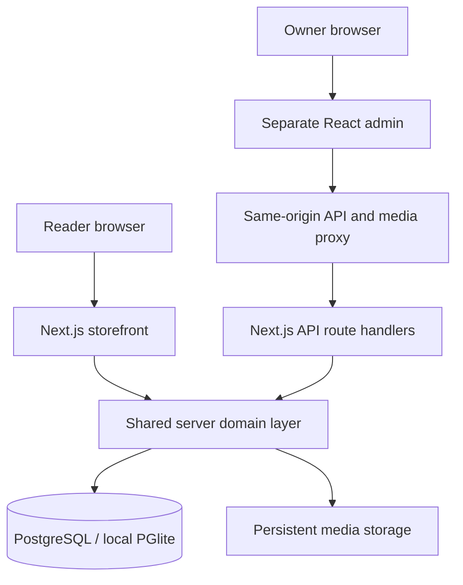

# Before You Forget Me v2 architecture

Status: implemented and locally verified on 15 October 2026. The user approved this stack and a separate full admin. Payments are deferred. There is no live site or external customer/order database to import.

## Applications and boundaries



Next.js serves public pages and the initial HTTP API. The independent React/Vite admin is hosted on its own origin. Both use one server-side domain layer and shared contracts; database access and credentials never enter the browser. A dedicated API deployment can be introduced if measured operational needs justify it.

```text
apps/storefront/    Next.js public routes, checkout and HTTP transport
apps/admin/         Separate React operational dashboard
packages/contracts/ Shared types and Zod request validation
packages/domain/    Authentication, catalogue, orders, content and API rules
packages/database/  SQL schema, migrations, persistent engine and seed
assets/source/      Preserved original images and journal copy
tools/              Setup, asset preparation, runtime and acceptance checks
tests/              Database/domain/API and checkout retry regression tests
docs/               Decisions, runbook and verification evidence
```

The pinned stack is Next.js 16.4.1, React 19.3.1, Vite 8.3.4 and TypeScript 5.9.3. Local runtime uses filesystem-persistent PGlite 0.5.10 because an external PostgreSQL service was unavailable. Production requires DATABASE_URL and uses the pg adapter. Local serialized transaction tests do not prove production row/advisory-lock behavior under load.

## Data and order rules

SQL tables store editions, posts, site settings, customers, orders/items/events, media, enquiries, administrators/sessions, rate limits and audit activity. Prices and totals are integer INR paise. Parameterized SQL and transactions enforce server-calculated order values and stock reservations. Item descriptions and prices are immutable order snapshots.

Orders begin pending_confirmation, unpaid and unfulfilled. Owner confirmation permits processing, then shipping and delivery. Reader cancellation is permitted while pending and restores stock once. Pending reservations have no automatic expiry; owner review is required. A shipping charge is provisional until personally agreed. There is no gateway, card input, paid state, payment SDK, COD promise or notification sender.

The unique idempotency key binds an order to its original request. Retrying after an ambiguous response retains the same payload/key. Only explicit business rejections emitted after existing-order recovery permit revising that attempt. A private guest token is required for order details/cancellation; the reference alone returns 404. Token hashes are stored. Customer deactivation blocks new orders while preserving history.

Admin edition edits send changed fields. Stock changes require an expected version checked against the locked record; stale changes return 409. Reservation/restoration updates advance the version, preventing an editor snapshot from silently putting stock back.

## Publication, security and storage

Public pages read fresh published records from the same domain layer used by admin. Draft and archived records are excluded; featured and sort controls drive home/shop. Personalized order/admin responses are not placed in shared caches. Missing edition/article/policy routes return real 404 responses before streaming; the global loading boundary was removed to avoid soft 404s.

Owner login creates a scoped server session with an HttpOnly cookie. Mutations require allowed exact origins and CSRF; resources authorize current sessions server-side. Requests have body/rate limits, and uploads validate size/type/pixels before re-encoding WebP. CSV exports neutralize formula prefixes. Private guest tokens are excluded from exports and audit records. Local owner credentials and uploads live in ignored .local storage.

Preserved originals have a SHA-256 manifest. WebP derivatives reduce delivery size, while the supplied cover, jacket, portrait and signature remain authentic. Upload storage needs a durable volume and backup policy in production. Local filesystem backups require stopping the embedded database first.

The current admin loads complete collections and filters/pages in the client. The earlier silent 200-record truncation is fixed. Indexed server pagination/search remains a scaling task before large operational volumes.

## Release boundary

This is a local implementation. The [runbook](RUNBOOK.md) defines production configuration, backup/restore and rollback work. Hosting, real PostgreSQL concurrency, HTTPS/reverse-proxy behavior, commercial prices/delivery/policies, external notifications and production monitoring require deployment-specific verification. No external resources were provisioned.
