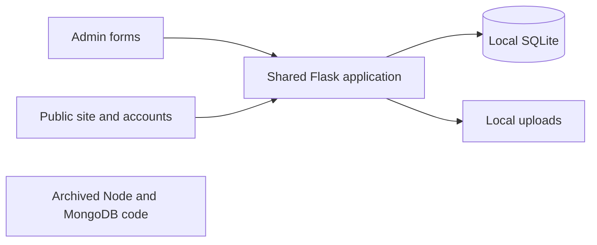

# Before You Forget Me discovery

The supplied project is an author/book storefront built on an older gym membership application. Its basic catalogue, account, journal and enquiry storage works, but several public views ignore saved fields, and the purchase journey stops at a membership-style request. A clean rebuild should preserve useful content and controls while introducing a real order model.

Current cycle: Phase 1 Discover, completed on 15 October 2026. Phase 2 Plan is next. Build, comprehensive testing, audit, fixes, verification, release and monitoring remain pending in that order.

## Orchestrator decision

| Skill or capability | Fit | Decision |
|---|---:|---|
| Architecture Designer | 9/10 | Used to map the system, compare architectures and define migration boundaries. |
| Fullstack Guardian | 9/10 | Used to trace database, interface and authorization requirements together. |
| Debugging Wizard | 8/10 | Used for specific hypotheses, isolated reproductions and evidence. |
| Browser inspection | 9/10 | Used against an isolated localhost instance for rendered contrast and the enquiry filter. |
| Write Page guidance | 8/10 | Used to make this local project handoff concise and reviewable. |
| Web Design Engineer | 9/10 for the later design/build phase | Candidate for the minimal storefront, dashboard and CSS motion. No visual rebuild has been generated yet. |
| Image generation | 8/10 when supporting artwork is needed | Deferred until an actual asset gap is established; preserve authoritative cover and author identity. |
| Motion Design / Motion Showreel | 3/10 for this request | Video-generation workflows do not fit restrained webpage interactions. |

Existing skills cover the task, so no new installed skill was necessary. The book-commerce acceptance checklist below extends the general website checklist.

| Activated agent | Returned result |
|---|---|
| Discovery and Architecture | Business/site inventory, current data paths, reusable assets, architecture alternatives and migration boundaries. |
| Frontend, Flow and Link Integrity | Storefront/admin field mismatches, broken seeded media, filter failure, contrast and branding issues; static endpoint/asset checks. |
| Backend and Data | Request-versus-order model, persistence and validation defects, security boundaries and isolated schema reproductions. |
| Orchestrator runtime verification | Temporary seeded database; 55 Flask test-client probes; actual browser checks of login and populated enquiry filtering. |
| Reviewer/Critic | Independently confirmed material findings, narrowed overbroad claims and approved discovery only. |

Dedicated comprehensive Security, Performance, SEO and Accessibility audits remain scheduled for Phase 5. The observations here establish the baseline, not conformance or release approval.

## Current system and journeys

| Area | Current behavior |
|---|---|
| Business | Before You Forget Me, a novel by Harshdeep Thakral; editions, author information, journal and enquiries. |
| Active stack | Flask, Jinja templates, plain CSS/JavaScript, local SQLite and filesystem image uploads; Waitress launcher and optional Windows executable packaging. |
| Legacy stack | Separate archived Node/Express/EJS/MongoDB code. It is not the active backend or a ready replacement. |
| Customer journey | Discover book → editions → detail → register/sign in → pending edition request → account. |
| Admin journey | Shared Flask app under `/admin`; edition/member/request/journal/enquiry management and CSV exports. |
| Data location | `NORD_DATA_DIR` override, otherwise the active project or executable's `data/nord.db` and `data/uploads`. |
| Existing data | No database/runtime uploads were supplied. The user confirmed no live site or external database. |

The legacy component has no connection to the active SQLite application. No external database connection was attempted.

## Findings from Backend and Architecture

Severity is business impact within the intended commercial release. A missing requested capability is identified as a requirement gap, rather than described as a regression.

| Severity | Finding and location | Evidence | Business impact | Fix and verification |
|---|---|---|---|---|
| P1 release requirement | Real orders are absent. [public.py:150](<C:/Users/mind8/Downloads/before you forgive me/before you forgive me/before_you_forget_me/app/blueprints/public.py:150>) and [db.py:46](<C:/Users/mind8/Downloads/before you forgive me/before you forgive me/before_you_forget_me/app/db.py:46>) | Request POST creates only an enrollment; schema has no order items, quantities, delivery address, price snapshot or order reference. Runtime schema confirmed no orders table. | A customer cannot place a complete actionable physical-book order. | Add transactional orders/items/address snapshots, server-calculated totals, idempotency and fulfillment history. Verify an order is visible to its customer and admin and retains its original values after product changes. |
| P1 before deployment | Development admin provisioning and archived credentials need replacement. [config.py:42](<C:/Users/mind8/Downloads/before you forgive me/before you forgive me/before_you_forget_me/app/config.py:42>); [legacy connection:2](<C:/Users/mind8/Downloads/before you forgive me/before you forgive me/before_you_forget_me/legacy_node/db/connection.js:2>) | Startup seeds a known development account; archived code embeds a remote database credential. Credential values were excluded from this handoff and never used to contact that service. | Copying these defaults into a public deployment risks unauthorized access. | Provision the new admin securely, add login throttling and production cookie controls, exclude archived credential files and revoke/rotate the archived credential if valid. Verify clean production startup has no development login. |
| P2 | Historical requests change with products. [auth.py:89](<C:/Users/mind8/Downloads/before you forgive me/before you forgive me/before_you_forget_me/app/blueprints/auth.py:89>); [db.py:48](<C:/Users/mind8/Downloads/before you forgive me/before you forgive me/before_you_forget_me/app/db.py:48>) | Runtime product rename/reprice changed the existing request's displayed title and price. Schema reproduction also confirmed cascading deletion. | Request history cannot act as an accurate commercial record. | Store immutable order-line snapshots and archive editions. Verify edits/deletion policy preserve order history. |
| P2 | Non-finite price causes a server error. [forms.py:60](<C:/Users/mind8/Downloads/before you forgive me/before you forgive me/before_you_forget_me/app/forms.py:60>) | Admin price `NaN` returned HTTP 500 in the isolated app instead of controlled validation. | A malformed field can interrupt catalogue editing. | Reject non-finite numbers; store money in minor units or exact decimal. Verify NaN/infinity/negative/range/valid-decimal cases. |
| P2 | Repeated article titles can fail. [admin.py:299](<C:/Users/mind8/Downloads/before you forgive me/before you forgive me/before_you_forget_me/app/blueprints/admin.py:299>) | Third same-title article creation on the same day returned HTTP 500 because the fallback slug also collided. | Editors lose the normal publishing flow. | Allocate unique slugs with conflict handling or actionable validation. Verify repeated creation and conflicting edits. |
| P2 risk | Media replacement precedes database success. [admin.py:93](<C:/Users/mind8/Downloads/before you forgive me/before you forgive me/before_you_forget_me/app/blueprints/admin.py:93>) | Source deletes the old image before committing the new database reference. A database-failure scenario was not injected. | A failed save can leave a broken reference or orphaned image. | Commit the new reference before cleaning unreferenced old media; clean new media on failure. Verify with an injected database-write failure. |
| P2 requirement | Admin is a URL section, not a separate website. [app factory:38](<C:/Users/mind8/Downloads/before you forgive me/before you forgive me/before_you_forget_me/app/__init__.py:38>) | Public/auth/admin blueprints are registered in one app; admin is an `/admin` prefix. | Current structure does not meet the requested separate admin deployment. | Build a separate admin frontend sharing the authoritative server layer; verify independent URLs/builds and server-side role checks. |

Positive controls worth preserving: role-guarded admin routes/exports, current active-user lookup, clearing sessions on login, CSRF protection on mutations, password hashing, parameterized input queries and decoded/re-encoded image uploads. These controls are not a complete security audit.

## Findings from Frontend and Flow agents

| Severity | Finding and location | Evidence | Business impact | Fix and verification |
|---|---|---|---|---|
| P2 | Public edition images ignore saved admin media. [shop template:5](<C:/Users/mind8/Downloads/before you forgive me/before you forgive me/before_you_forget_me/app/templates/public/packages.html:5>); [detail template:5](<C:/Users/mind8/Downloads/before you forgive me/before you forgive me/before_you_forget_me/app/templates/public/package_detail.html:5>) | A custom image saved successfully but neither public response contained its saved filename. Both templates hard-code the cover. | Administrators cannot control customer-visible edition artwork. | Use the persisted media reference everywhere. Verify two different editions and replacement images across admin, listing and detail. |
| P2 | Homepage ignores available editions. [public.py:78](<C:/Users/mind8/Downloads/before you forgive me/before you forgive me/before_you_forget_me/app/blueprints/public.py:78>); [home template:5](<C:/Users/mind8/Downloads/before you forgive me/before you forgive me/before_you_forget_me/app/templates/public/home.html:5>) | The query supplies active editions ordered by feature status, but the template never consumes them. A new featured edition was absent at runtime. | The dashboard's homepage-feature promise does not work. | Add the agreed featured-editions section. Verify feature, visibility and ordering changes render correctly. |
| P2 | Fresh-seed journal images return 404. [seed.py:107](<C:/Users/mind8/Downloads/before you forgive me/before you forgive me/before_you_forget_me/app/seed.py:107>) | Two distinct emitted image URLs returned 404; source files exist under `img/book/` instead. This affects the three seeded articles. | Broken cards and article covers reduce reader confidence. | Normalize asset references and validate seed/import URLs. Verify both seeded and uploaded media return 200 and decode. |
| P2 | Populated enquiry/request filters crash. [app.js:49](<C:/Users/mind8/Downloads/before you forgive me/before you forgive me/before_you_forget_me/app/static/js/app.js:49>) | Browser recorded an empty-selector SyntaxError. Typing a nonmatching enquiry query left the unrelated row visible. Request template has the same missing optional counter attribute; request UI was not separately exercised. | Staff cannot reliably search these operational lists. | Guard optional selectors and provide consistent filter components. Verify populated/empty lists, clear search and no console errors. |
| P2 | Public authentication/account contrast is poor. [author.css:28](<C:/Users/mind8/Downloads/before you forgive me/before you forgive me/before_you_forget_me/app/static/css/author.css:28>) | Browser rendered the login heading as RGB(246,237,219) on a white card; calculated contrast is about 1.16:1. Public account/table text and mobile navigation toggle contrast conflicts are source-supported. | Customers struggle to read sign-in and account information. | Correct surface/text tokens; verify rendered text, focus and controls across breakpoints. The separate admin theme is excluded from this blanket claim. |
| P2 | Gym and implementation copy remains customer-visible. [confirmation:165](<C:/Users/mind8/Downloads/before you forgive me/before you forgive me/before_you_forget_me/app/blueprints/public.py:165>); [login:23](<C:/Users/mind8/Downloads/before you forgive me/before you forgive me/before_you_forget_me/app/templates/auth/login.html:23>) | Runtime confirmation still promises club membership; login says Nord; account/shop templates retain membership or development text. | Brand confusion undermines purchase confidence. | Rewrite all customer states around books and honest order/payment status. Verify headings, flashes, empty states and confirmations. |
| P3 | Search/share metadata is incomplete. [base.html:5](<C:/Users/mind8/Downloads/before you forgive me/before you forgive me/before_you_forget_me/app/templates/base.html:5>) | Shared description/OG defaults; no canonical or structured data found. Local robots and sitemap URLs returned 404. Missing robots.txt alone does not prevent crawling. | Reduced control over snippets, discovery and shared previews. No live indexing failure was established. | Add route-specific metadata, canonical policy, sitemap and suitable Book/Article data; verify public deployed URLs. |
| P3 | Images, motion and some labels need refinement. [home.html:20](<C:/Users/mind8/Downloads/before you forgive me/before you forgive me/before_you_forget_me/app/templates/public/home.html:20>) | Cover is about 1.44 MB and jacket 0.88 MB; responsive variants/dimensions and reduced-motion handling are absent; some admin upload/note controls lack labels. | Avoidable mobile download cost and accessibility friction. CWV and cross-device conformance were not measured. | Generate optimized derivatives, set dimensions, lazy-load below-fold media, label controls and respect reduced motion; measure after implementation. |

## Verification and scope

The parent agent installed the current app's Flask/Pillow/Waitress runtime dependencies in a temporary folder, disabled bytecode writes to source, and set `NORD_DATA_DIR` to a new temporary directory before importing the app. No original database was opened and no real customer data was used.

The 55 test-client probes included public/admin routes, actual seeded article routes, rendered local asset URLs, admin sign-in, member registration/authorization, CSRF rejection, edition publication, image/feature propagation, inactive-edition visibility, invalid prices, repeated titles, request creation/retry, account history and enquiry persistence. Results: 43 passed their expected condition; 12 did not. Multiple failed conditions can describe one issue; some conditions represent requested new capabilities.

Browser verification used the isolated localhost app. It confirmed the login visual problem and computed colors; signed into the temporary admin; opened populated enquiries; recorded the JavaScript exception; and entered a nonmatching filter value while the row remained visible. No third-party mail, messaging, payments or database calls were made.

Agent static checks matched 107 literal template endpoint references to declared endpoint names and found 15 literal static references present on disk. These counts exclude dynamic database media, which were checked separately. The existing bundled smoke script was not run as a passing suite: its admin email and one article slug still refer to the old gym seed.

The original app's name/price publication, hidden-edition behavior, enquiry saving, basic accounts, admin authorization and CSRF controls worked in the exercised cases. The evidence does not support calling the entire backend pipeline broken.

## Ordered fix and build plan

Effort S means a localized task, M a connected feature, and L a substantial module. These are scope estimates, not delivery-date promises.

| Order | Work | Effort | Owner | Acceptance gate |
|---:|---|:---:|---|---|
| 1 | Finalize editions, order states, fulfillment rules and public/admin boundaries | M | Discovery and Architecture | Reviewable data/API/route plan; payment deferral explicit. |
| 2 | Shared types, validation, database migrations, controlled admin setup and session boundaries | M | Architecture and Backend | Fresh setup and restart persistence; unauthorized access rejected. |
| 3 | Admin → edition save/publish → public listing/detail/homepage | M | Backend and Frontend | Correct title, price, media, ordering and publication state on every view. |
| 4 | Durable direct orders with immutable snapshots, address, totals, idempotency and status history | L | Backend and Flow Tester | Retry/concurrency tests; account and admin agree; no false paid state. |
| 5 | Full admin catalogue/orders/customers/content/enquiries/media/settings dashboard | L | Frontend and Backend | Concrete coverage inventory in the architecture brief; no placeholder operational screens. |
| 6 | Minimal public site, supplied identity/artwork, responsive behavior and restrained motion | L | Frontend and Design | Agreed visual direction, readable auth/account screens, keyboard/reduced-motion support. |
| 7 | Targeted tests, full security/performance/SEO/accessibility/link audits, fixes and Critic review | L | Test and Audit agents | Measured results, re-tested fixes and explicit release verdict. |
| 8 | Staging, backups/restore rehearsal, deployment and rollback | M | Architecture and Release | Release checklist and smoke tests pass. |
| 9 | Uptime/errors/orders/content freshness/CWV monitoring after release | M | Operations | Alerts and ownership configured after the deployment environment is chosen. |

## Critic verdict and open decisions

Discovery is approved. The Critic confirmed the material field/media/order/filter findings and rejected overbroad claims about all data being disconnected or the admin theme being unreadable. No production security, performance, SEO or accessibility sign-off is granted.

No unanswered question blocks discovery. Phase 2 must define real edition prices, quantities/stock, delivery coverage/charges, contact identity and the fulfillment policy while payment integration is deferred. The provisional design records orders as unpaid and pending manual confirmation; it does not assume COD or a payment provider.

Checklist additions from this project: verify admin media/featured flags on every public view; verify fresh-seed media; retain immutable order history after product changes; test third duplicate titles; reject non-finite money; exercise search on populated admin tables; test auth/account contrast after global theme changes; check all customer-facing domain language.
